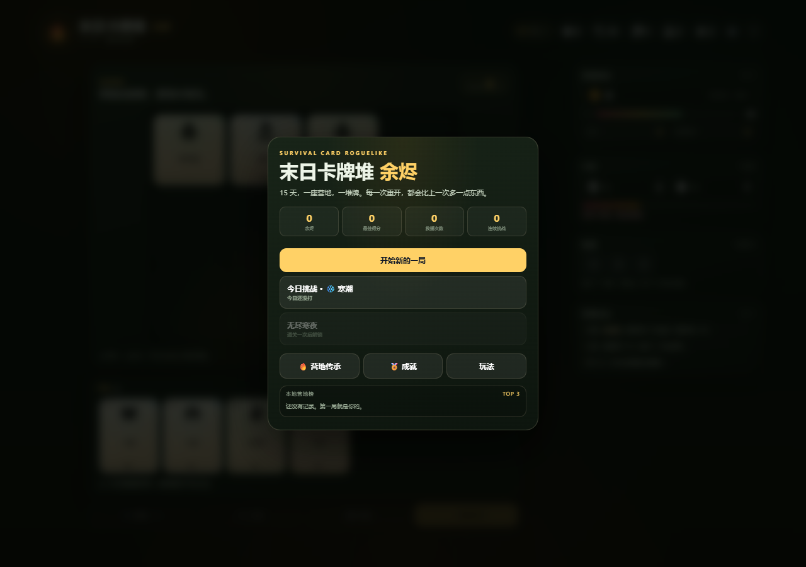
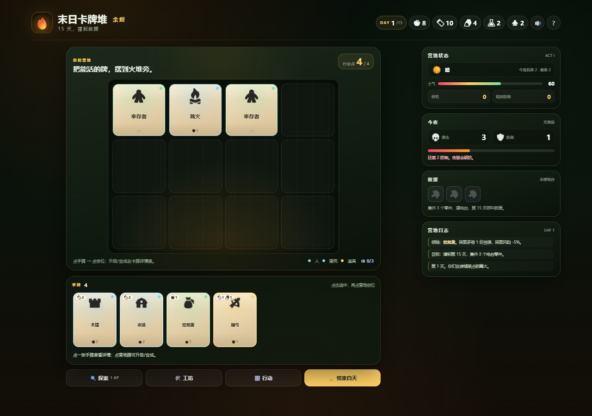

# 末日卡牌堆 · 余烬 2.1

一个可以直接在浏览器里玩的单机卡牌生存游戏。不是微信小游戏代码，但玩法、数值、UI 都是按“以后能缩到小游戏”的方向做的。





## 怎么运行

双击 `index.html`，用 Chrome / Edge 打开即可。无需安装、无需服务器。

如果手机测试：

```bash
python -m http.server 8000
```

手机访问电脑局域网 IP 的 8000 端口。

## 2.1 新增：让人想开下一局

- **余烬传承**：每局结束获得余烬，回营地买永久升级（食物/木头/金属/药品/士气/保暖）。
- **3 个领袖**：拾荒者（探索收益/风险）、工程师（工坊/升级折扣）、医者（药品/恢复）。
- **今日挑战**：每天固定种子 + 随机规则（寒潮/掠夺者/浓雾/丰收），当天最高分、连续挑战天数。
- **无尽寒夜**：通关一次后解锁；没有第 15 天，夜袭一直变强，冲最高分。
- **成就**：活过第 5 天、首次救援、Lv.3、5 幸存者、累计探索 10 次、3 次救援等。
- **S/A/B/C 评级**：不只是“赢/输”，高士气 + 多幸存者才能拿 S。
- **本地营地榜**：保存前 5 名，回营地能看到上一局排第几。

## 2.0 的核心系统

- **15 天**长局，分 3 幕；第 15 天判定救援。
- **4 行动点/天**，能做的事情更多。
- **卡牌升级**：木墙/哨塔/庇护所/农场/集水器/篝火/工作台都能升 Lv.2-3。
- **工坊制造**：花资源直接造牌，不用等抽牌。
- **营地行动**：加固防线、热汤、治疗、研究、空投补给。
- **探索队伍**：派 1-2 名幸存者出门，选地点，带回资源/卡牌；外出的人当晚不防守，也可能受伤。
- **士气 / 天气 / 柴火 / 受伤**：低士气减产、柴不够冻伤、伤员不能工作。
- **7 个合成配方**：木墙+木墙=庇护所、木墙+陷阱=尖刺墙、庇护所+农场=家园、哨塔+陷阱=瞭望塔等。
- **破防选择**：夜袭防御不够时，可以牺牲一张牌，或者让一个人受伤。

## 参考 / 设计方向

- 《杀戮尖塔》的卡牌 roguelike 与进阶思路：每局不同、失败也有收获。
- 《吸血鬼幸存者》的永久强化：用上一局换来的资源，让下一局更强。
- 微信小游戏常见的每日挑战、成就、本地榜、短目标，用来制造“明天再来一局”的理由。

## 玩法

- **目标**：撑到第 15 天，集齐 3 个电台零件，建电台，呼叫救援。
- **每天 4 行动点**：打牌、探索、工坊制造、营地行动都要花 AP。
- **打牌**：点手牌 → 点营地空位。卡牌有资源费用。
- **升级**：点营地牌 → 详情里点“升级”。升级需要资源 + 研究点。
- **合成**：点两张营地牌，例如木墙+木墙=庇护所、木墙+陷阱=尖刺墙。
- **相邻加成**：篝火挨着厨师、农场挨着集水器、哨塔挨着木墙、工作台挨着工程师等。
- **夜晚**：烧柴 → 营地生产 → 所有人吃饭 → 怪物袭击。防御不够就要牺牲牌或让人受伤。
- **探索**：每天一次，派 1-2 人；电台零件只在废弃电台。
- **救援**：3 个零件 + 电台卡，撑到第 15 天 = 好结局；否则是“活下来但没等到救援”。

## 操作

- 点手牌选中；点营地空位打出。
- 点营地牌查看详情；再点另一张尝试合成；详情里可升级。
- `探索`：选人 → 选地点。
- `工坊`：花 1 AP + 资源制造卡牌。
- `行动`：加固/热汤/治疗/研究/空投。
- `结束白天`：进入夜晚。
- 主界面：开始新局 / 今日挑战 / 无尽寒夜 / 营地传承 / 成就 / 本地榜。
- 右上角可以开关声音、重看教程。
- 每局一次“空投补给”（模拟广告）：食物 +2、木头 +2、金属 +1。

## 内容量

- **22 张卡**：7 类幸存者 + 15 类建筑/道具/合成物。
- **7 个合成配方**、**7 组相邻加成**、**6 个探索地点**、**6 个随机事件**。
- **3 个领袖**、**6 项永久传承**、**6 个成就**、**每日挑战**、**无尽模式**、**3 种结局**。
- 一局约 15-25 分钟；无尽模式看能撑多久。

## 文件结构

```text
.
├── index.html      页面骨架
├── style.css       全部 UI / 卡牌 / 动效
├── game.js         数据 + 状态 + 规则 + UI
├── ASSETS.md       素材来源 / 许可证 / 替换说明
├── preview-home.png
├── preview.png
└── assets/
    ├── icons/      Kenney Board Game Icons（CC0 1.0）
    ├── audio/      Kenney Board Game Pack（CC0 1.0）
    └── licenses/   许可证原文
```

## 存档

- 传承、余烬、成就、每日最高分、本地榜保存在浏览器 `localStorage`。
- 清浏览器数据会清空存档；没有服务器存档。

## 素材

- 图标：[Kenney Board Game Icons](https://kenney.nl/assets/board-game-icons)（CC0 1.0）
- 音效：[Kenney Board Game Pack](https://kenney.nl/assets/boardgame-pack)（CC0 1.0）
- 详细映射和替换方式见 [ASSETS.md](ASSETS.md)。

## 已知限制

- 这是 Web 原型，没有微信登录、真实广告、云存档、好友排行榜。
- 数值只做了第一轮平衡，极端打法可能过难/过易。
- 手机小屏需要滚动；桌面/平板体验最好。
- 每日挑战/本地榜是单机存档，不是服务器排行榜。

## 下一步可以做什么

1. 把每日挑战/无尽榜接到微信开放数据域，做好友排行。
2. 加更多领袖、事件、卡牌、敌人类型和“赛季”规则。
3. 移植到 Cocos Creator 3.8 + TypeScript，做微信小游戏版本。
4. 接 `minigame-api-typings`、官方 `minigame-demo`，做广告/分享/好友榜。
